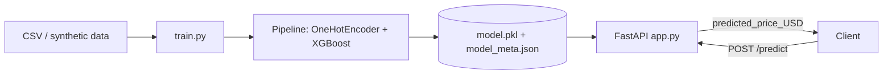

<div align="center">

# ✈️ Flight Fare Prediction API

**An end-to-end ML service: XGBoost + scikit-learn pipeline served with FastAPI**


</div>

---

## 📌 Overview

Predicts a flight's fare (USD) from the route and fare type, and exposes the model through a validated REST API.

> **Transparency note:** the bundled model is trained on a **synthetic demo dataset** (~18k rows, 10 airports), so the metrics below verify that the *pipeline* works and are **not real-world accuracy**. The training script also supports the real Expedia dataset (see [Using real data](#-using-real-expedia-data)).

## ✨ Features

- 🧱 **One sklearn `Pipeline`**: `OneHotEncoder` (airports) + `XGBRegressor`, so training and inference share identical preprocessing (no train/serve skew)
- 📏 **Honest evaluation**: MAE, RMSE and R² on a held-out 20% split, compared with a mean-fare baseline
- ⚡ **FastAPI + Uvicorn** with the model loaded once at startup
- 🛡️ **Pydantic validation**: bad payloads get a `422`; unseen or identical airports are rejected with a clear message
- 📦 **Chunked CSV loader** for large files: column pruning, dtype downcasting, random sampling
- 🏎️ **Built-in load-test script** to measure your own latency and throughput

## 🏗️ Architecture



## 📊 Results (synthetic demo data)

| Metric | Value |
|---|---|
| Rows / airports | 17,997 / 10 |
| R² | **0.84** |
| MAE | **$24.18** |
| RMSE | $30.56 |
| Baseline MAE (predict mean) | $61.79 |

**API load test** (local laptop, single Uvicorn worker, 2,000 requests, 20 concurrent clients, 0 errors):

| Throughput | p50 latency | p95 latency | p99 latency |
|---|---|---|---|
| ~129 req/s | 120 ms | 196 ms | 248 ms |

*Measured with `benchmark.py`; results vary by machine.*

## 🚀 Quick Start

```bash
git clone https://github.com/hetpatel-28/flight-fare-predictor.git
cd flight-fare-predictor
pip install -r requirements.txt

python train.py                      # trains on demo data, creates model.pkl
python -m uvicorn app:app --port 8000
```

Open **http://127.0.0.1:8000/docs** for the interactive Swagger UI.

### Example request

```bash
curl -X POST http://127.0.0.1:8000/predict \
  -H "Content-Type: application/json" \
  -d '{
        "startingAirport": "JFK",
        "destinationAirport": "LAX",
        "isBasicEconomy": false,
        "isRefundable": true,
        "isNonStop": true
      }'
```

```json
{ "predicted_price_USD": 266.02 }
```

### Endpoints

| Method | Path | Description |
|---|---|---|
| GET | `/` | Status + training mode |
| GET | `/health` | Health check |
| POST | `/predict` | Predict fare for a route |

## 📈 Using real Expedia data

```bash
# quick test
python train.py --data itineraries.csv --sample 50000
# larger run
python train.py --data itineraries.csv --sample 1000000
```

The loader reads the CSV in chunks, keeps only the needed columns, downcasts dtypes, and samples rows. Required columns: `startingAirport`, `destinationAirport`, `isBasicEconomy`, `isRefundable`, `isNonStop`, `totalFare`.

## ⚡ Benchmark your own machine

```bash
python -m uvicorn app:app --port 8000      # terminal 1
python benchmark.py --n 2000 --concurrency 20   # terminal 2
```

## 🗂️ Project structure

```
├── app.py            # FastAPI service
├── train.py          # training + evaluation, saves pipeline
├── benchmark.py      # load-test script
├── model_meta.json   # metrics + known airports
├── requirements.txt
└── README.md
```

## ⚠️ Limitations

- Trained on synthetic data by default, so metrics are not real-world accuracy
- Only 5 features; real fares depend heavily on booking lead time, dates, duration and airline
- Random (not time-based) train/test split
- Airports unseen during training are rejected

## 🛣️ Roadmap

- [ ] Train and report results on the full Expedia dataset
- [ ] Add date, lead-time, duration and airline features
- [ ] Time-based split and cross-validation
- [ ] Docker image and CI
- [ ] Endpoint unit tests

## 👤 Author

**Het Patel**, [GitHub](https://github.com/hetpatel-28)